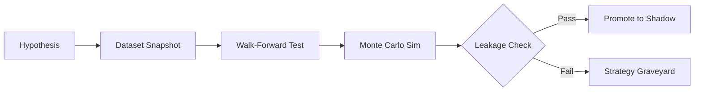
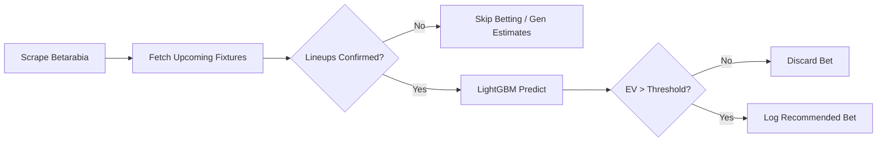
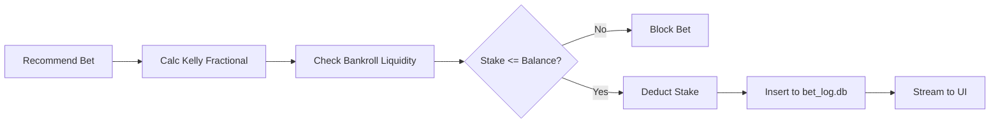

# DeepFieldPro: Institutional-Grade Quantitative Sports Betting Platform


## ≡اù Executive Summary
DeepFieldPro is a **fully integrated, institutional-grade quantitative sports betting platform** that transforms theoretical research into live market validation. The system combines stealth data acquisition, scientific backtesting, continuous shadow deployment, and rigorous risk management to answer one critical question:

> **"Does our edge survive real-world market conditions, latency, and sportsbook adaptation?"**

---

## ≡اأ€ Core System Features

### 1. Data Acquisition & Infrastructure
*   **24/7 Live Data Acquisition:** Playwright-based browser orchestration with anti-detection fingerprinting.
*   **Immutable Odds Storage:** Local SQLite time-series storage for every market movement.
*   **WebSocket Ingestor:** Live frame interception with automatic reconnection and stream health monitoring.
*   **Odds Normalizer:** Cross-book market mapping and odds conversion.

### 2. Research Operating System (Research OS)
*   **Experiment Registry:** Immutable tracking of research hypotheses and results.
*   **Scientific Validation:** Walk-forward testing, Monte Carlo simulation, and leakage detection.
*   **Strategy Lifecycle:** Automated state transitions (Research → Shadow → Production).
*   **Edge Decay Analyzer:** EV half-life measurement and latency sensitivity testing.

### 3. Live Operations & Execution
*   **Live Prediction Daemon:** Continuous background polling of fixtures and AI evaluation.
*   **Shadow Deployment:** Continuous paper trading with real-time CLV tracking.
*   **Edge Decay Monitor:** Real-time monitoring of EV evaporation.
*   **Strict Lineup Validator:** Zero-tolerance lineup checking before execution.

### 4. Risk & Portfolio Management
*   **Risk Engine:** Fractional Kelly sizing, exposure caps, and automated kill-switches.
*   **Capital Allocation:** Dynamic bankroll distribution across strategies.
*   **Liquidity & Impact:** Market-impact-aware stake sizing to prevent detection.

---

## ≡اôè Operational Workflows

### Phase 1: Discovery (Research)


### Phase 2: Live Inference Loop


### Phase 3: Capital Execution


---

## ≡اأخ Getting Started

### Prerequisites
- Python 3.10+
- Node.js 18+ (for Playwright)

### Quick Start
1. **Clone & Setup:**
   ```bash
   git clone https://github.com/UnderratedGignac/DeepFieldPro.git
   cd DeepFieldPro
   cp .env.example .env
   # Edit .env with your credentials
   ```
2. **Install Dependencies:**
   ```bash
   pip install -r requirements.txt
   playwright install chromium
   playwright install-deps chromium
   ```
3. **Initialize & Run:**
   ```bash
   python src/database/migrate.py
   python src/orchestrator.py
   ```
4. **Access:** Open `http://localhost:5000` (Dashboard).

---
*Built with precision for institutional-grade quantitative sports betting research.*
