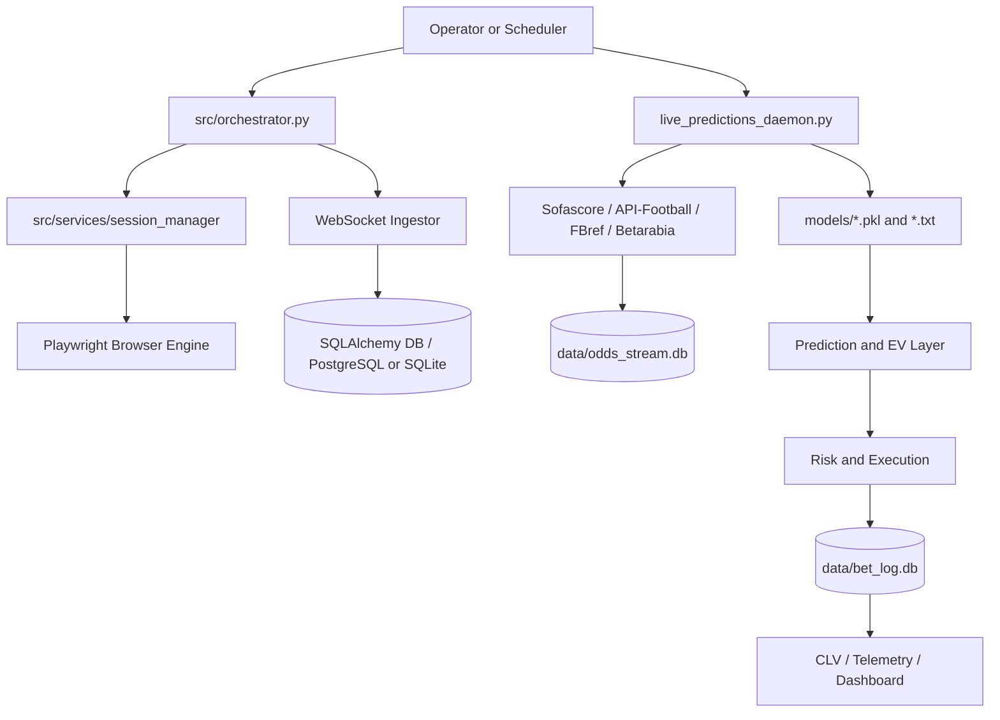

# DeepFieldPro

Institutional-style football betting research and operations platform.

DeepFieldPro combines live sportsbook/fixture acquisition, lineup-aware prediction, LightGBM and sklearn model inference, Poisson market pricing, bankroll/risk controls, CLV tracking, telemetry, and dashboards. The codebase is Python-first and currently contains both a service-oriented acquisition stack and a local SQLite/script-driven live prediction workflow.

## What It Does

- Scrapes and normalizes football fixtures, lineups, player statistics, and odds.
- Captures Betarabia/Kickertech markets and supports sportsbook browser/WebSocket infrastructure.
- Loads trained model artifacts from `models/` for player, team, prop, and match prediction.
- Prices betting markets using model outputs, quantile bands, and Poisson probability transforms.
- Applies risk controls, staking logic, no-bet filters, CLV tracking, and settlement workflows.
- Exposes dashboard/API surfaces for monitoring predictions, odds, sessions, and metrics.

## Main Runtime Paths

| Purpose | Command |
|---|---|
| Initialize SQLAlchemy schema | `python src/database/migrate.py` |
| Start service-oriented acquisition stack | `python src/orchestrator.py` |
| Start live prediction loop | `python src/live_predictions_daemon.py` |
| Run scheduled jobs | `python src/scheduler_daemon.py` |
| Start FastAPI API | `uvicorn src.api.main:app --host 0.0.0.0 --port 8000` |
| Start Streamlit dashboard | `streamlit run src/dashboard.py` |

## Architecture



## Repository Map

| Path | Purpose |
|---|---|
| `src/api/` | FastAPI health, session, browser, WebSocket, odds, market, and metrics endpoints. |
| `src/services/` | Service-oriented browser session, odds acquisition, backtesting, risk, CLV, normalization, and shadow execution modules. |
| `src/database/` | SQLAlchemy models and migration entry point. |
| `src/data_acquisition/` | Betarabia acquisition, lineup parsing, validation, repricing, replay, execution simulation, and raw frame handling. |
| `src/research/`, `src/meta_research/` | Research governance, validation, policy outcome auditing, and readiness tooling. |
| `src/portfolio_optimization/`, `src/capital_*` | Allocation, drawdown, liquidity, rollout, and capital scaling modules. |
| `src/telemetry_warehouse/`, `src/live_operations/` | CLV, account health, data quality, alerting, and telemetry archiving. |
| `models/` | LightGBM text boosters and serialized sklearn/LightGBM/joblib artifacts. |
| `data/` | Local SQLite databases, JSON state, CSV datasets, screenshots/probe artifacts, and migrations. |
| `db/` | Adaptive memory and adversarial telemetry SQLite stores. |
| `tests/` | Import and pipeline smoke/e2e tests. |

## Setup

### Prerequisites

- Python 3.10+
- Playwright-compatible browser dependencies
- Optional: PostgreSQL/Redis if running a fuller service deployment

### Install

```bash
python -m venv .venv
.venv\Scripts\activate
pip install -r requirements.txt
playwright install chromium
```

On Linux servers, also run:

```bash
playwright install-deps chromium
```

### Configure

```bash
copy .env.example .env
```

Edit `.env` locally with API keys and sportsbook credentials. Do not commit `.env`.

Common configuration areas include:

- API-Football / RapidAPI credentials
- Betfair credentials and certificate path
- Telegram alert credentials
- Database URL
- Browser/scraper runtime flags

## Running Locally

Initialize the database schema:

```bash
python src/database/migrate.py
```

Start the acquisition orchestrator:

```bash
python src/orchestrator.py
```

Or start the live prediction daemon:

```bash
python src/live_predictions_daemon.py
```

Start the API:

```bash
uvicorn src.api.main:app --host 0.0.0.0 --port 8000
```

Useful API endpoints:

- `GET /health`
- `GET /ready`
- `GET /live`
- `GET /metrics`
- `GET /sessions`
- `GET /browser/status`
- `GET /websocket/status`

## Data Stores

| Store | Purpose |
|---|---|
| `data/bet_log.db` | Bet records, predictions, STAIR order mapping. |
| `data/odds_stream.db` | Betarabia fixture and market rows. |
| `data/bankroll.db` | Daily bankroll and exposure tracking. |
| `data/sync_state.db` | League/page sync state for data fetching. |
| `src/data/deepfield.db` | SQLAlchemy fallback database for service stack. |
| `db/adaptive_memory.sqlite` | Execution outcomes and market regime history. |
| `db/adversarial_telemetry.sqlite` | Account telemetry and sportsbook behavior signals. |

## Models

The repository includes LightGBM text boosters and serialized model artifacts for:

- Expected minutes
- Passes
- Shots
- Shots on target
- Goals
- Cards
- Offsides
- Bottom-up match prediction
- Player impact
- Calibration

Model runners load artifacts from `models/` and combine predictions with opponent profiles, lineup status, current odds, and market-pricing functions.

## Documentation

Detailed generated documentation lives in:

- `SYSTEM_AUDIT_DOCUMENTATION.md`
- `FILE_INVENTORY_DEEPFIELDPRO.md`
- `DEEPFIELD_AUDIT_REPORT.md`
- `USER_GUIDE.md`
- `IMPLEMENTATION_PLAN.md`

## Testing

Run the available test suite with:

```bash
pytest
```

The project also includes several script-level smoke tests under `src/` and `tests/`.

## Security Notes

- Do not commit `.env` or credentials.
- Treat `*.pkl` and joblib model files as trusted artifacts only.
- Move hardcoded API keys out of source before production deployment.
- Add authentication and rate limiting before exposing `src/api/main.py` publicly.
- Keep sportsbook/browser profiles isolated from development machines in production.

## Operational Notes

- Betarabia scraping failures are usually debugged with `data/betarabia_page_probe.html` and `data/betarabia_screenshot.png`.
- Missing players are logged so datasets and fallback mappings can be improved.
- Local SQLite workflows are convenient for development, but high-frequency odds ingestion should move to PostgreSQL/TimescaleDB for production scale.
- The codebase contains legacy and newer service paths; check `SYSTEM_AUDIT_DOCUMENTATION.md` before consolidating runtime behavior.
