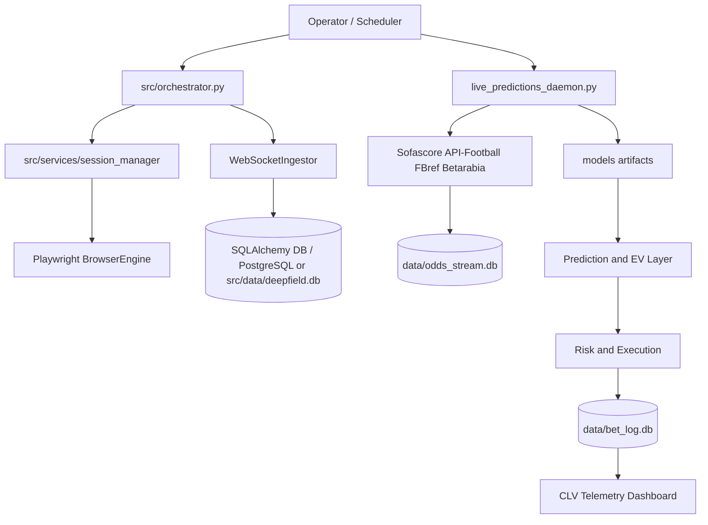
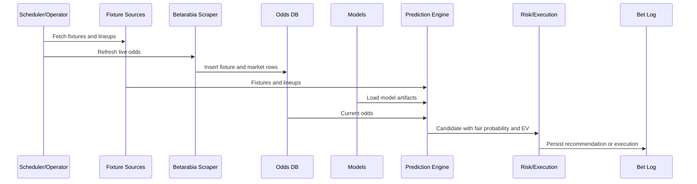
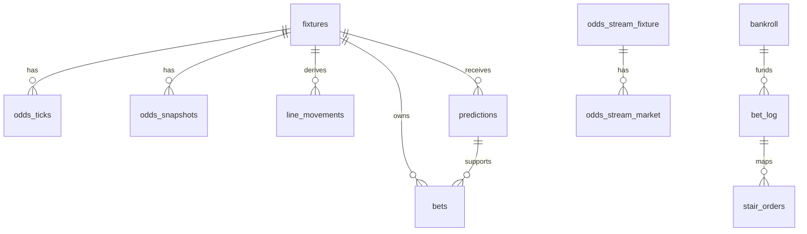
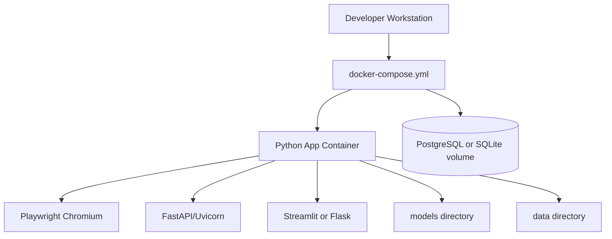

# DeepFieldPro Enterprise System Documentation

Updated from repository inspection on 2026-06-08. Sensitive values from `.env` are intentionally not reproduced.

## 1. Executive Summary
DeepFieldPro is a Python quantitative football betting research and operations platform. It combines live acquisition, sportsbook/browser automation, historical data pipelines, LightGBM/sklearn prediction models, Poisson market pricing, risk controls, CLV tracking, shadow execution, telemetry, and dashboards.

## 2. System Overview
The repository contains two coexisting runtime styles: a service-oriented acquisition stack under `src/services`, `src/api`, `src/database`, and `src/orchestrator.py`; and a local SQLite/script workflow centered on `src/live_predictions_daemon.py`, `src/model_runner.py`, `src/betarabia_scraper.py`, `data/*.db`, and `models/*`.

Core commands: `python src/database/migrate.py`, `python src/orchestrator.py`, `python src/live_predictions_daemon.py`, `python src/scheduler_daemon.py`, `uvicorn src.api.main:app --host 0.0.0.0 --port 8000`, and `streamlit run src/dashboard.py`.

## 3. Repository Structure

- Total files listed: **2098**
- Non-cache Python files parsed: **359**

### File Type Counts
|Extension|Count|
|---|---|
|.gz|1329|
|.py|387|
|.pyc|188|
|<none>|47|
|.txt|29|
|.db|23|
|.md|23|
|.pkl|16|
|.csv|15|
|.json|15|
|.tag|3|
|.log|3|
|.bat|3|
|.yml|2|
|.html|2|
|.sqlite|2|
|.lock|2|
|.example|1|
|.png|1|
|.sql|1|
|.sh|1|
|.browser|1|
|.ini|1|
|.toml|1|
|.lnk|1|
|.parquet|1|

### Top-Level Counts
|Location|Count|
|---|---|
|src|1906|
|.ruff_cache|39|
|data|38|
|models|38|
|<root>|33|
|.mypy_cache|18|
|artifacts|10|
|.pytest_cache|5|
|tests|4|
|db|2|
|.github|1|
|__pycache__|1|
|downloaded_files|1|
|logs|1|
|telemetry_warehouse|1|

## 4. High-Level Architecture

## 5. Services
|Service|Files|Responsibility|Inputs|Outputs|Failure Modes|
|---|---|---|---|---|---|
|Session Manager|src/services/session_manager/service.py, browser_engine.py|Playwright contexts, session auth, health checks, circuit breaker|session id, sportsbook, credentials|context/session state, metrics|auth failure, browser crash, rate limit|
|WebSocket Ingestion|src/services/odds_acquisition/websocket_ingestor.py|Parse/intercept live odds messages|browser/WebSocket frames|odds ticks, metrics|disconnect, stale stream, schema drift|
|Betarabia Scraping|src/betarabia_scraper.py, src/data_acquisition/betarabia_scraper.py, src/odds_scraper_betarabia.py|Capture fixtures and player-prop markets|Betarabia/Kickertech pages/API|odds_stream.db, probe artifacts|Cloudflare, DOM/API changes|
|Prediction Engine|src/live_predictions_daemon.py, src/model_runner.py, src/model_runner_v2.py, src/generate_predictions.py|Fixture/player probabilities and EV|fixtures, lineups, odds, models|predictions, dashboard state, bet candidates|missing models/data/odds|
|Risk/Execution|src/execution_engine.py, src/kelly_calculator.py, src/risk_engine, src/services/risk_engine/engine.py|Stake sizing, exposure gates, bet registration|fair probability, odds, bankroll|bet log, bankroll updates, alerts|stop-loss, limit, insufficient balance|
|Telemetry/CLV|src/clv_tracker.py, src/clv_updater.py, src/telemetry_warehouse, src/live_operations|Closing-line value, data quality, account health|bets, closing odds, latency|CLV rows/reports, alerts|missing closing odds, stale markets|
|Research/Simulation|src/services/backtesting, src/research, src/autonomous_portfolio_evolution, src/capital_*|Replay, validation, policy audit, capital lifecycle|historical events, strategy states|metrics, lifecycle decisions|insufficient history, overfit policy|

## 6. Workflows

## 7. AI Models
|Artifact|Type|Objective|Features/Notes|Bytes|
|---|---|---|---|---|
|models\bottom_up_match_model.pkl|Serialized sklearn/LightGBM/joblib artifact|binary|not unpickled during documentation generation|499665|
|models\cards_mean.txt|LightGBM text booster|regression|Age Position_encoded Minutes_Played Mn/Start Percentage_of_Minutes_Played Crs Interceptions Tackles_Won ppda opp_possession_allowed sample_weight|872007|
|models\goals_mean.txt|LightGBM text booster|regression|Age Position_encoded Minutes_Played Mn/Start Percentage_of_Minutes_Played Crs Interceptions Tackles_Won ppda opp_possession_allowed sample_weight|878668|
|models\lgb_min__final.txt|LightGBM text booster|regression|min__roll3 min__roll10 Performance_Gls_roll3 Performance_Gls_roll10 Performance_Ast_roll3 Performance_Ast_roll10 Performance_Sh_roll3 Performance_Sh_roll10 Perf|431166|
|models\lgb_Performance_Ast_final.txt|LightGBM text booster|regression|min__roll3 min__roll10 Performance_Gls_roll3 Performance_Gls_roll10 Performance_Ast_roll3 Performance_Ast_roll10 Performance_Sh_roll3 Performance_Sh_roll10 Perf|421563|
|models\lgb_Performance_CrdY_final.txt|LightGBM text booster|regression|min__roll3 min__roll10 Performance_Gls_roll3 Performance_Gls_roll10 Performance_Ast_roll3 Performance_Ast_roll10 Performance_Sh_roll3 Performance_Sh_roll10 Perf|438338|
|models\lgb_Performance_Gls_final.txt|LightGBM text booster|regression|min__roll3 min__roll10 Performance_Gls_roll3 Performance_Gls_roll10 Performance_Ast_roll3 Performance_Ast_roll10 Performance_Sh_roll3 Performance_Sh_roll10 Perf|411898|
|models\lgb_Performance_Sh_final.txt|LightGBM text booster|regression|min__roll3 min__roll10 Performance_Gls_roll3 Performance_Gls_roll10 Performance_Ast_roll3 Performance_Ast_roll10 Performance_Sh_roll3 Performance_Sh_roll10 Perf|415197|
|models\lgb_Performance_SoT_final.txt|LightGBM text booster|regression|min__roll3 min__roll10 Performance_Gls_roll3 Performance_Gls_roll10 Performance_Ast_roll3 Performance_Ast_roll10 Performance_Sh_roll3 Performance_Sh_roll10 Perf|425756|
|models\lgbm_assists.pkl|Serialized sklearn/LightGBM/joblib artifact|binary|not unpickled during documentation generation|2841813|
|models\lgbm_goals.pkl|Serialized sklearn/LightGBM/joblib artifact|binary|not unpickled during documentation generation|2536072|
|models\lgbm_minutes.pkl|Serialized sklearn/LightGBM/joblib artifact|binary|not unpickled during documentation generation|2828113|
|models\lgbm_minutes_v1.pkl|Serialized sklearn/LightGBM/joblib artifact|binary|not unpickled during documentation generation|297391|
|models\lgbm_passes_v1.pkl|Serialized sklearn/LightGBM/joblib artifact|binary|not unpickled during documentation generation|1011738|
|models\lgbm_shots.pkl|Serialized sklearn/LightGBM/joblib artifact|binary|not unpickled during documentation generation|3523073|
|models\lgbm_shots_on_target.pkl|Serialized sklearn/LightGBM/joblib artifact|binary|not unpickled during documentation generation|3351321|
|models\lgbm_sot_club_v1.pkl|Serialized sklearn/LightGBM/joblib artifact|binary|not unpickled during documentation generation|795860|
|models\lgbm_sot_international_v2.pkl|Serialized sklearn/LightGBM/joblib artifact|binary|not unpickled during documentation generation|799853|
|models\lgbm_yellow_cards.pkl|Serialized sklearn/LightGBM/joblib artifact|binary|not unpickled during documentation generation|2760129|
|models\minutes_p10_regressor.txt|LightGBM text booster|quantile|Age Starts Percentage_of_Minutes_Played Mn/Start Mn/MP PPM ppda opp_possession_allowed sample_weight|179275|
|models\minutes_p50_regressor.txt|LightGBM text booster|quantile|Age Starts Percentage_of_Minutes_Played Mn/Start Mn/MP PPM ppda opp_possession_allowed sample_weight|152709|
|models\minutes_p90_regressor.txt|LightGBM text booster|quantile|Age Starts Percentage_of_Minutes_Played Mn/Start Mn/MP PPM ppda opp_possession_allowed sample_weight|179985|
|models\minutes_start_classifier.txt|LightGBM text booster|binary sigmoid:1|Age Starts Percentage_of_Minutes_Played Mn/Start Mn/MP PPM ppda opp_possession_allowed sample_weight|3248|
|models\offsides_mean.txt|LightGBM text booster|regression|Age Position_encoded Minutes_Played Mn/Start Percentage_of_Minutes_Played Crs Interceptions Tackles_Won ppda opp_possession_allowed sample_weight|875693|
|models\passes_p10.txt|LightGBM text booster|quantile|Age Position_encoded Minutes_Played Mn/Start Percentage_of_Minutes_Played Crs Interceptions Tackles_Won ppda opp_possession_allowed sample_weight|283942|
|models\passes_p50.txt|LightGBM text booster|quantile|Age Position_encoded Minutes_Played Mn/Start Percentage_of_Minutes_Played Crs Interceptions Tackles_Won ppda opp_possession_allowed sample_weight|292214|
|models\passes_p90.txt|LightGBM text booster|quantile|Age Position_encoded Minutes_Played Mn/Start Percentage_of_Minutes_Played Crs Interceptions Tackles_Won ppda opp_possession_allowed sample_weight|291844|
|models\platt_scaler_sot.pkl|Serialized sklearn/LightGBM/joblib artifact|binary|not unpickled during documentation generation|712|
|models\player_goal_lgbm.pkl|Serialized sklearn/LightGBM/joblib artifact|binary|not unpickled during documentation generation|11341|
|models\player_impact_model.pkl|Serialized sklearn/LightGBM/joblib artifact|binary|not unpickled during documentation generation|1295841|
|models\shots_p10.txt|LightGBM text booster|quantile|Age Position_encoded Minutes_Played Mn/Start Percentage_of_Minutes_Played Crs Interceptions Tackles_Won ppda opp_possession_allowed sample_weight|2269448|
|models\shots_p50.txt|LightGBM text booster|quantile|Age Position_encoded Minutes_Played Mn/Start Percentage_of_Minutes_Played Crs Interceptions Tackles_Won ppda opp_possession_allowed sample_weight|2842746|
|models\shots_p90.txt|LightGBM text booster|quantile|Age Position_encoded Minutes_Played Mn/Start Percentage_of_Minutes_Played Crs Interceptions Tackles_Won ppda opp_possession_allowed sample_weight|2936867|
|models\sot_p10.txt|LightGBM text booster|quantile|Age Position_encoded Minutes_Played Mn/Start Percentage_of_Minutes_Played Crs Interceptions Tackles_Won ppda opp_possession_allowed sample_weight|2253448|
|models\sot_p50.txt|LightGBM text booster|quantile|Age Position_encoded Minutes_Played Mn/Start Percentage_of_Minutes_Played Crs Interceptions Tackles_Won ppda opp_possession_allowed sample_weight|2363606|
|models\sot_p90.txt|LightGBM text booster|quantile|Age Position_encoded Minutes_Played Mn/Start Percentage_of_Minutes_Played Crs Interceptions Tackles_Won ppda opp_possession_allowed sample_weight|2942589|
|models\team_goals_lgbm.pkl|Serialized sklearn/LightGBM/joblib artifact|binary|not unpickled during documentation generation|60647|
|models\training_meta.pkl|Serialized sklearn/LightGBM/joblib artifact|binary|not unpickled during documentation generation|903|

LightGBM is used for fast tabular inference; quantile objectives provide p10/p50/p90 uncertainty bands; Poisson transforms rates into market probabilities; pickle/joblib artifacts must be trusted and version-pinned.

## 8. Databases
The project uses SQLAlchemy models plus several SQLite stores.

### `data\bankroll.db`
- Size: 16384 bytes
- Objects: 3
#### `bankroll`
|Column|Type|PK|Default|
|---|---|---|---|
|id|INTEGER|1||
|date|DATE|0||
|starting_balance|REAL|0||
|current_balance|REAL|0||
|peak_balance|REAL|0||
|daily_exposure|REAL|0||
|daily_pnl|REAL|0||
|system_status|TEXT|0|'ACTIVE'|

### `data\bet_log.db`
- Size: 290816 bytes
- Objects: 6
#### `bet_log`
|Column|Type|PK|Default|
|---|---|---|---|
|bet_id|TEXT|1||
|match_id|TEXT|0||
|player_id|TEXT|0||
|market_type|TEXT|0||
|line|DECIMAL(5,1)|0||
|side|TEXT|0||
|entry_odds|DECIMAL(6,3)|0||
|fair_odds|DECIMAL(6,3)|0||
|edge_pct|DECIMAL(5,3)|0||
|stake|DECIMAL(10,2)|0||
|book|TEXT|0||
|placed_at|TIMESTAMP|0||
|lineup_drop_at|TIMESTAMP|0||
|latency_ms|INTEGER|0||
|closing_odds|DECIMAL(6,3)|0||
|clv|DECIMAL(5,3)|0||
|result|TEXT|0||
|pnl|DECIMAL(10,2)|0||
|regime|TEXT|0||
|role_shift_flag|BOOLEAN|0||
|bet_source|TEXT|0|'AI'|
|is_recommended|INTEGER|0|0|
#### `predictions`
|Column|Type|PK|Default|
|---|---|---|---|
|fixture_id|TEXT|1||
|match_name|TEXT|0||
|league|TEXT|0||
|kickoff|TEXT|0||
|prediction|TEXT|0||
|expected_score|TEXT|0||
|home_prob|REAL|0||
|draw_prob|REAL|0||
|away_prob|REAL|0||
|over_prob|REAL|0||
|under_prob|REAL|0||
|btts_yes_prob|REAL|0||
|btts_no_prob|REAL|0||
|has_lineup|INTEGER|0||
|predicted_at|TIMESTAMP|0||
|extra_json|TEXT|0||
#### `stair_orders`
|Column|Type|PK|Default|
|---|---|---|---|
|bet_id|TEXT|1||
|order_id|TEXT|0||

### `data\odds_stream.db`
- Size: 499712 bytes
- Objects: 4
#### `fixture`
|Column|Type|PK|Default|
|---|---|---|---|
|fixture_id|TEXT|1||
|home_team|TEXT|0||
|away_team|TEXT|0||
|kickoff_time|TEXT|0||
|kickoff_date|TEXT|0||
|league_id|TEXT|0||
|tournament_name|TEXT|0||
|scraped_at|TEXT|0||
#### `market`
|Column|Type|PK|Default|
|---|---|---|---|
|market_id|TEXT|1||
|fixture_id|TEXT|0||
|market_name|TEXT|0||
|selection_name|TEXT|0||
|raw_odds|REAL|0||
|prop_player|TEXT|0||
|prop_type|TEXT|0||
|prop_line|REAL|0||
|scraped_at|TEXT|0||

### `data\sync_state.db`
- Size: 57344 bytes
- Objects: 2
#### `league_sync`
|Column|Type|PK|Default|
|---|---|---|---|
|league_id|INTEGER|1||
|season|INTEGER|2||
|total_pages|INTEGER|0|0|
|pages_fetched|INTEGER|0|0|
|status|TEXT|0|'PENDING'|

### `db\adaptive_memory.sqlite`
- Size: 20480 bytes
- Objects: 4
#### `execution_outcomes`
|Column|Type|PK|Default|
|---|---|---|---|
|exec_id|TEXT|1||
|fixture_id|TEXT|0||
|market_type|TEXT|0||
|player_name|TEXT|0||
|lineup_confidence|REAL|0||
|theoretical_ev|REAL|0||
|realized_ev|REAL|0||
|execution_status|TEXT|0||
|failure_classification|TEXT|0||
|bot_latency_ms|REAL|0||
|bookmaker_latency_ms|REAL|0||
|slippage_ticks|REAL|0||
|market_volatility_at_execution|REAL|0||
|timestamp|TEXT|0||
#### `market_regime_history`
|Column|Type|PK|Default|
|---|---|---|---|
|id|INTEGER|1||
|fixture_id|TEXT|0||
|market_type|TEXT|0||
|regime_classification|TEXT|0||
|velocity_score|REAL|0||
|timestamp|TEXT|0||

### `db\adversarial_telemetry.sqlite`
- Size: 12288 bytes
- Objects: 2
#### `account_telemetry`
|Column|Type|PK|Default|
|---|---|---|---|
|id|INTEGER|1||
|timestamp|REAL|0||
|avg_confirmation_delay_ms|REAL|0||
|rejection_rate_pct|REAL|0||
|suspension_aggressiveness_score|REAL|0||
|session_uptime_hours|REAL|0||

### `src\data\bet_log.db`
- Size: 20480 bytes
- Objects: 4
#### `bets`
|Column|Type|PK|Default|
|---|---|---|---|
|bet_id|TEXT|1||
|timestamp|TEXT|0||
|player_name|TEXT|0||
|team|TEXT|0||
|market|TEXT|0||
|selection|TEXT|0||
|entry_odds|REAL|0||
|stake|REAL|0||
|fair_prob|REAL|0||
|status|TEXT|0|'open'|
|outcome|TEXT|0||
|profit_loss|REAL|0||
|closing_odds|REAL|0||
|clv_percentage|REAL|0||
|uncertainty_spread|REAL|0||
|kickoff_time|TEXT|0||
#### `predictions`
|Column|Type|PK|Default|
|---|---|---|---|
|fixture_id|TEXT|1||
|match_name|TEXT|0||
|league|TEXT|0||
|kickoff|TEXT|0||
|prediction|TEXT|0||
|expected_score|TEXT|0||
|home_prob|REAL|0||
|draw_prob|REAL|0||
|away_prob|REAL|0||
|over_prob|REAL|0||
|under_prob|REAL|0||
|btts_yes_prob|REAL|0||
|btts_no_prob|REAL|0||
|has_lineup|INTEGER|0||
|predicted_at|TIMESTAMP|0||
|extra_json|TEXT|0||

### `src\data\deepfield.db`
- Size: 266240 bytes
- Objects: 61
#### `bankroll_snapshots`
|Column|Type|PK|Default|
|---|---|---|---|
|id|INTEGER|1||
|total_bankroll|FLOAT|0||
|available_bankroll|FLOAT|0||
|exposed_bankroll|FLOAT|0||
|total_profit_loss|FLOAT|0||
|bets_count|INTEGER|0||
|winning_bets|INTEGER|0||
|losing_bets|INTEGER|0||
|recorded_at|DATETIME|0||
#### `bets`
|Column|Type|PK|Default|
|---|---|---|---|
|id|INTEGER|1||
|fixture_id|INTEGER|0||
|prediction_id|INTEGER|0||
|sportsbook|VARCHAR|0||
|market_type|VARCHAR|0||
|selection|VARCHAR|0||
|stake|FLOAT|0||
|odds|FLOAT|0||
|potential_return|FLOAT|0||
|status|VARCHAR|0||
|result|FLOAT|0||
|placed_at|DATETIME|0||
|settled_at|DATETIME|0||
#### `browser_health`
|Column|Type|PK|Default|
|---|---|---|---|
|id|BIGINT|1||
|browser_id|VARCHAR|0||
|memory_mb|FLOAT|0||
|cpu_percent|FLOAT|0||
|context_count|INTEGER|0||
|page_count|INTEGER|0||
|is_healthy|BOOLEAN|0||
|crash_count|INTEGER|0||
|uptime_seconds|INTEGER|0||
|metrics|JSON|0||
|recorded_at|DATETIME|0||
|created_at|DATETIME|0||
#### `fixtures`
|Column|Type|PK|Default|
|---|---|---|---|
|id|INTEGER|1||
|api_id|VARCHAR|0||
|home_team|VARCHAR|0||
|away_team|VARCHAR|0||
|league|VARCHAR|0||
|country|VARCHAR|0||
|kickoff_time|DATETIME|0||
|status|VARCHAR|0||
|home_score|INTEGER|0||
|away_score|INTEGER|0||
|created_at|DATETIME|0||
|updated_at|DATETIME|0||
#### `ingestion_metrics`
|Column|Type|PK|Default|
|---|---|---|---|
|id|BIGINT|1||
|bucket_start|DATETIME|0||
|bucket_end|DATETIME|0||
|sportsbook|VARCHAR|0||
|ticks_ingested|INTEGER|0||
|fixtures_tracked|INTEGER|0||
|websocket_messages|INTEGER|0||
|http_requests|INTEGER|0||
|successes|INTEGER|0||
|failures|INTEGER|0||
|timeouts|INTEGER|0||
|avg_latency_ms|FLOAT|0||
|p95_latency_ms|FLOAT|0||
|p99_latency_ms|FLOAT|0||
|websocket_uptime_pct|FLOAT|0||
|reconnect_count|INTEGER|0||
|created_at|DATETIME|0||
#### `line_movements`
|Column|Type|PK|Default|
|---|---|---|---|
|id|BIGINT|1||
|fixture_id|INTEGER|0||
|first_tick_id|VARCHAR(64)|0||
|last_tick_id|VARCHAR(64)|0||
|sportsbook|VARCHAR|0||
|market_type|VARCHAR|0||
|outcome|VARCHAR|0||
|start_odds|NUMERIC(10, 5)|0||
|end_odds|NUMERIC(10, 5)|0||
|min_odds|NUMERIC(10, 5)|0||
|max_odds|NUMERIC(10, 5)|0||
|movement_pct|FLOAT|0||
|start_time|DATETIME|0||
|end_time|DATETIME|0||
|duration_seconds|INTEGER|0||
|movement_type|VARCHAR|0||
|created_at|DATETIME|0||
#### `odds`
|Column|Type|PK|Default|
|---|---|---|---|
|id|INTEGER|1||
|fixture_id|INTEGER|0||
|sportsbook|VARCHAR|0||
|market_type|VARCHAR|0||
|odds_data|JSON|0||
|collected_at|DATETIME|0||
#### `odds_snapshots`
|Column|Type|PK|Default|
|---|---|---|---|
|id|BIGINT|1||
|snapshot_id|VARCHAR(64)|0||
|fixture_id|INTEGER|0||
|captured_at|DATETIME|0||
|odds_data|JSON|0||
|source_count|INTEGER|0||
|market_count|INTEGER|0||
|created_at|DATETIME|0||
#### `odds_ticks`
|Column|Type|PK|Default|
|---|---|---|---|
|id|BIGINT|1||
|tick_id|VARCHAR(64)|0||
|fixture_id|INTEGER|0||
|sportsbook|VARCHAR|0||
|market_type|VARCHAR|0||
|outcome|VARCHAR|0||
|odds_before|NUMERIC(10, 5)|0||
|odds_after|NUMERIC(10, 5)|0||
|sequence_number|INTEGER|0||
|timestamp|DATETIME|0||
|ingested_at|DATETIME|0||
#### `predictions`
|Column|Type|PK|Default|
|---|---|---|---|
|id|INTEGER|1||
|fixture_id|INTEGER|0||
|model_name|VARCHAR|0||
|model_version|VARCHAR|0||
|predicted_outcome|VARCHAR|0||
|confidence|FLOAT|0||
|probability_home|FLOAT|0||
|probability_draw|FLOAT|0||
|probability_away|FLOAT|0||
|recommended_market|VARCHAR|0||
|recommended_selection|VARCHAR|0||
|fair_odds|FLOAT|0||
|kelly_stake|FLOAT|0||
|created_at|DATETIME|0||
#### `session_logs`
|Column|Type|PK|Default|
|---|---|---|---|
|id|BIGINT|1||
|session_id|VARCHAR|0||
|sportsbook|VARCHAR|0||
|event_type|VARCHAR|0||
|state_before|VARCHAR|0||
|state_after|VARCHAR|0||
|health_score|FLOAT|0||
|consecutive_failures|INTEGER|0||
|requests_total|INTEGER|0||
|requests_failed|INTEGER|0||
|error_message|TEXT|0||
|recovery_attempted|BOOLEAN|0||
|recovery_successful|BOOLEAN|0||
|occurred_at|DATETIME|0||
|created_at|DATETIME|0||
#### `websocket_events`
|Column|Type|PK|Default|
|---|---|---|---|
|id|BIGINT|1||
|session_id|VARCHAR|0||
|sportsbook|VARCHAR|0||
|event_type|VARCHAR|0||
|url|VARCHAR|0||
|message_count|INTEGER|0||
|error_message|TEXT|0||
|occurred_at|DATETIME|0||
|duration_ms|INTEGER|0||
|metrics|JSON|0||
|created_at|DATETIME|0||

### `src\live_data.db`
- Size: 32768 bytes
- Objects: 7
#### `lineup_history`
|Column|Type|PK|Default|
|---|---|---|---|
|id|INTEGER|1||
|fixture_id|TEXT|0||
|source|TEXT|0||
|lineup_payload|TEXT|0||
|lineup_version|INTEGER|0||
|timestamp|TEXT|0||
#### `odds_history`
|Column|Type|PK|Default|
|---|---|---|---|
|id|INTEGER|1||
|fixture_id|TEXT|0||
|market|TEXT|0||
|player_name|TEXT|0||
|old_odds|REAL|0||
|new_odds|REAL|0||
|movement|REAL|0||
|timestamp|TEXT|0||
#### `odds_stream`
|Column|Type|PK|Default|
|---|---|---|---|
|id|INTEGER|1||
|fixture_id|TEXT|0||
|bookmaker|TEXT|0||
|market|TEXT|0||
|player_name|TEXT|0||
|normalized_name|TEXT|0||
|line|REAL|0||
|side|TEXT|0||
|decimal_odds|REAL|0||
|implied_probability|REAL|0||
|market_status|TEXT|0||
|scraped_at|TEXT|0||
#### `parsed_lineups`
|Column|Type|PK|Default|
|---|---|---|---|
|id|INTEGER|1||
|fixture_id|TEXT|0||
|player_name|TEXT|0||
|normalized_name|TEXT|0||
|team|TEXT|0||
|starter|BOOLEAN|0||
|position|TEXT|0||
|formation|TEXT|0||
|source|TEXT|0||
|confidence_score|REAL|0||
|scraped_at|TEXT|0||

### ER Diagram

## 9. Agents
|Agent|Files|Trigger|Logic|Output|
|---|---|---|---|---|
|Live prediction daemon|src/live_predictions_daemon.py|180-second loop|fixture status, kickoff window, lineup/odds availability|predictions, dashboard JSON, bet logs|
|Scheduler daemon|src/scheduler_daemon.py|APScheduler cron|candidate scan, final confirmation, settlement, calibration|updated predictions and bet rows|
|APEL|src/autonomous_portfolio_evolution|research/simulation|strategy lifecycle and variant spawning|active strategy states|
|CDP|src/capital_deployment_protocol|daily lifecycle/execution request|rollout phase, drift budget, safety locks|allocation or rollback|
|ACSI|src/capital_scaling_intelligence|capital trajectory evaluation|regime, EV forecast, risk optimizer|scaling decision|
|Market repricing/edge|src/data_acquisition/dynamic_repricer.py, edge_engine.py|lineup/odds events|fair probabilities, friction, liquidity|execution candidates|
|Shadow execution|src/services/shadow_execution/engine.py, shadow_mode modules|candidate bet/shadow lab|acceptance, drift, browser state|shadow bets and telemetry|

## 10. Scheduled Jobs
|Job|File|Schedule|Inputs|Outputs|Recovery|
|---|---|---|---|---|---|
|platt_recalibration|src/scheduler_daemon.py|monthly day 1 03:00 UTC|bet/results data|updated Platt scaler|rerun calibration_trainer.py|
|generate_candidates_1|src/scheduler_daemon.py|daily 11:30 UTC|fixtures/models|candidate predictions|rerun generate_predictions|
|final_confirmation_1|src/scheduler_daemon.py|daily 13:45 UTC|candidate JSON/live odds|executed/skipped statuses|rerun after odds recovery|
|daily_settlement|src/scheduler_daemon.py|daily 23:00 UTC|open bets/results|settled bets|rerun scan_and_settle|
|live prediction sweep|src/live_predictions_daemon.py|while True + 180 seconds|fixtures/odds/lineups|DB and dashboard refresh|restart process|
|Betarabia polling|src/odds_scraper_betarabia.py|while True + POLL_INTERVAL|Betarabia pages|odds stream rows|restart scraper|
|heartbeat|src/heartbeat.py|while True + 60 seconds|service URL|health output|restart process|

## 11. API Documentation
|Method|Endpoint|Behavior|
|---|---|---|
|GET|/health|Comprehensive health check.|
|GET|/ready|Readiness probe.|
|GET|/live|Liveness probe.|
|GET|/session/status/{session_id}|Session state, auth state, failures, health score.|
|GET|/sessions|List active sessions.|
|POST|/session/create|Create sportsbook session.|
|POST|/session/authenticate|Authenticate session with credentials dict.|
|DELETE|/session/{session_id}|Close session.|
|GET|/browser/status|Browser metrics.|
|POST|/browser/restart|Restart browser.|
|GET|/websocket/status/{sportsbook}|One sportsbook WebSocket status.|
|GET|/websocket/status|All WebSocket statuses.|
|GET|/odds/live/{fixture_id}|Latest odds placeholder/DB-backed target.|
|GET|/odds/history/{fixture_id}|Historical odds placeholder/DB-backed target.|
|GET|/markets/active|Active markets placeholder.|
|GET|/metrics|Prometheus text metrics.|
Authentication is not enforced in `src/api/main.py`; production should add auth, rate limiting, and audit logging.

## 12. Infrastructure and Deployment
`Dockerfile`, `Dockerfile.browser`, `docker-compose.yml`, `.github/workflows/deepfield_pipeline.yml`, `deploy_deepfieldpro.sh`, and Windows `.bat` launchers define local/container/CI operations.

## 13. Operations Guide
1. Install Python 3.10+ and dependencies from `requirements.txt`.
2. Install Playwright browser dependencies.
3. Copy `.env.example` to `.env` and configure secrets locally.
4. Run `python src/database/migrate.py`.
5. Start acquisition with `python src/orchestrator.py` or live predictions with `python src/live_predictions_daemon.py`.
6. Start API/dashboard as required.
7. Monitor `data/*.db`, `src/data/deepfield.db`, logs, and `/metrics`.

## 14. Monitoring, Troubleshooting, Security, Scalability
Use `/health`, `/ready`, `/live`, and `/metrics`; inspect `data/bet_log.db`, `data/odds_stream.db`, `src/data/deepfield.db`; verify model artifacts under `models/`; check Betarabia probe HTML/screenshot on scraper failure; treat pickle/joblib as trusted only; move hardcoded STAIR-AI key material to environment variables; add auth to API; migrate high-frequency odds data to PostgreSQL/TimescaleDB with partitioning.

## 15. Future Improvements
Consolidate duplicate runtime paths, add a model registry with feature schemas and metrics, add idempotent migrations for every SQLite store, add parser drift tests for Betarabia, and separate scrapers/inference/settlement into queue-backed workers.
